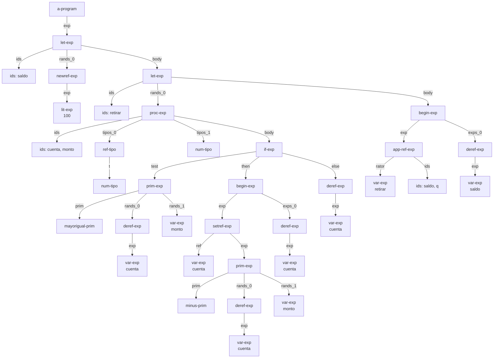
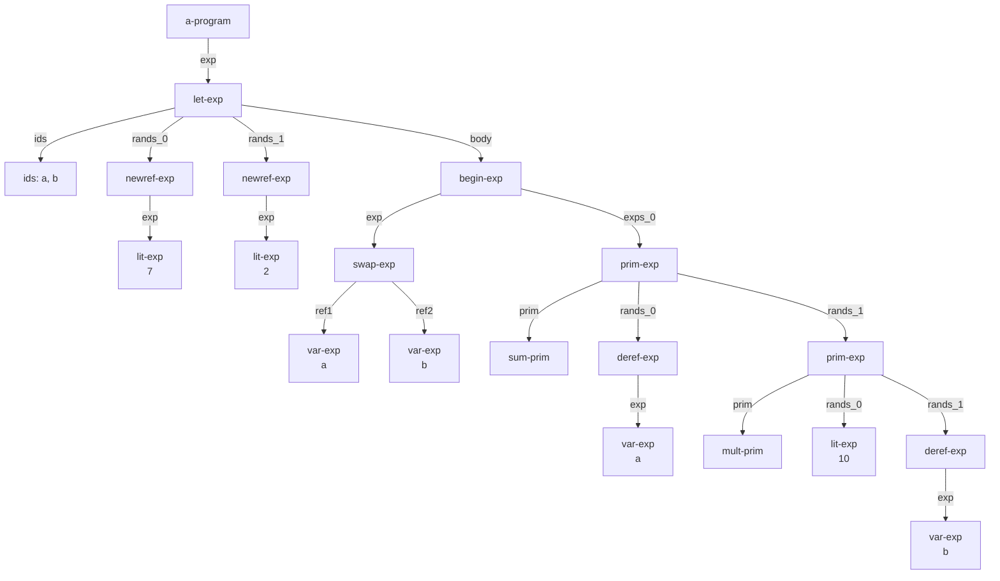
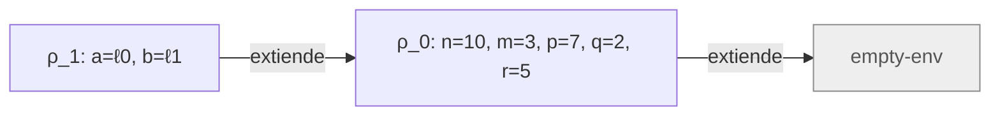
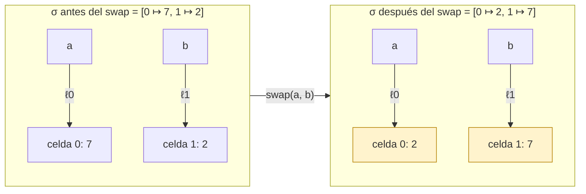

# Informe de AST — Taller 3: Memoria y disciplina

**Curso:** Fundamentos de Interpretación y Compilación de Lenguajes
de Programación — Universidad del Valle, Sede Tuluá.

**Integrantes del grupo:**

| Nombre | Código | Correo institucional |
|--------|--------|----------------------|
| Aura Maria Pelaez Luna | 2459422 | aura.pelaez@correounivalle.edu.co |
| Valentina Valencia Lopez | 2459626 | valentina.valencia.lopez@correounivalle.edu.co |

---

## 1. Gramática considerada

Gramática de Cauca con referencias y tipos (`src/sintaxis.rkt`). Entre
paréntesis, los campos de cada constructor del datatype.

```bnf
<programa>  ::= <expresion>                                  a-program(exp)

<expresion> ::= <numero>                                     lit-exp(dato)
            ::= <identificador>                              var-exp(id)
            ::= "true"                                       true-exp()
            ::= "false"                                      false-exp()
            ::= <primitiva> "(" {<expresion>}*(,) ")"          prim-exp(prim, rands)
            ::= "if" <expresion> "then" <expresion>
                "else" <expresion> "end"                     if-exp(test, then, else)
            ::= "let" {<identificador> "=" <expresion>}*
                "in" <expresion> "end"                       let-exp(ids, rands, body)
            ::= "proc" "(" {<identificador> ":" <tipo>}*(,) ")"
                <expresion> "end"                            proc-exp(ids, tipos, body)
            ::= "apply" <expresion> "(" {<expresion>}*(,) ")"  app-exp(rator, rands)
            ::= "letrec" {<tipo> <identificador>
                "(" {<identificador> ":" <tipo>}*(,) ")"
                "=" <expresion>}* "in" <expresion> "end"        letrec-exp(tipos-res, proc-names,
                                                                 idss, tipos-args, bodies, body)
            ::= "case" <expresion> {"of" <numero> "=>" <expresion>}*
                "otherwise" "=>" <expresion> "end"           case-exp(exp, valores, acciones, default)
            ::= "newref" "(" <expresion> ")"                 newref-exp(exp)
            ::= "deref" "(" <expresion> ")"                  deref-exp(exp)
            ::= "setref" "(" <expresion> "," <expresion> ")" setref-exp(ref, exp)
            ::= "swap" "(" <expresion> "," <expresion> ")"   swap-exp(ref1, ref2)
            ::= "begin" <expresion> {";" <expresion>}* "end"   begin-exp(exp, exps)
            ::= "applyref" <expresion>
                "(" {<identificador>}*(,) ")"                  app-ref-exp(rator, ids)

<tipo>      ::= "num"                                        num-tipo()
            ::= "bool"                                       bool-tipo()
            ::= "refto" "(" <tipo> ")"                       ref-tipo(t)
            ::= "(" {<tipo>}*(*) "->" <tipo> ")"               proc-tipo(args, res)

<primitiva> ::= "+" | "-" | "*" | "/" | "add1" | "sub1" | "not" | "abs"
              | ">" | ">=" | "<" | "<=" | "==" | "and" | "or" | "xor"
              | "implica" | "mcd" | "mcm" | "promedio" | "entre"
                (constructores sum-prim, minus-prim, mult-prim, div-prim, add-prim,
                 sub-prim, not-prim, abs-prim, mayor-prim, mayorigual-prim,
                 menor-prim, menorigual-prim, igual-prim, and-prim, or-prim,
                 xor-prim, implica-prim, mcd-prim, mcm-prim, promedio-prim,
                 entre-prim)
```

---

## 2. Ejemplos de AST

En los diagramas, las aristas llevan el nombre del campo del constructor;
las listas de identificadores se dibujan como una hoja (`ids: a, b`) y las
listas de expresiones o de tipos como hijos numerados (`rands_0`, `rands_1`,
...). Los nodos de tipo (`ref-tipo`, `num-tipo`) forman parte del árbol.

### Ejemplo 1 — Programa `saldo` (Parte 4.1)

**Expresión concreta:**

```scheme
let saldo = newref(100)
in
  let retirar = proc (cuenta : refto(num), monto : num)
                  if >=(deref(cuenta), monto)
                  then begin
                         setref(cuenta, -(deref(cuenta), monto));
                         deref(cuenta)
                       end
                  else deref(cuenta)
                  end
                end
  in
    begin
      applyref retirar (saldo, q);
      deref(saldo)
    end
  end
end
```

**AST:**



**Explicación:** la raíz `a-program` tiene un `let-exp` externo que liga
`saldo` a un `newref-exp` sobre el literal 100. Su cuerpo es otro `let-exp`
que liga `retirar` a un `proc-exp`; los dos parámetros llevan sus nodos de
tipo: `cuenta : refto(num)` es un `ref-tipo` con un `num-tipo` adentro y
`monto : num` es un `num-tipo`. El cuerpo del procedimiento es un `if-exp`
cuya condición es un `prim-exp` con `mayorigual-prim`, cuya rama `then` es
un `begin-exp` (un `setref-exp` seguido de un `deref-exp`) y cuya rama `else`
es un `deref-exp`. El cuerpo del `let` interno es un `begin-exp` con un
`app-ref-exp` (operador `retirar`, identificadores `saldo` y `q`) y un
`deref-exp`.

**Por qué no pasa el chequeador.** `applyref` exige que cada identificador
tenga tipo `refto(s)` (regla `applyref` del enunciado: $\Gamma(x_i) = t_i$ y
$t_i = \text{refto}(s_i)$). Aquí `q` viene del ambiente inicial con tipo `num`,
así que el chequeador se detiene con:

```text
type-of: applyref exige identificadores de tipo refto(t); q tiene tipo num
```

Dos cosas más están mal con esa llamada. El parámetro `monto` está
declarado como `num`, y la regla pide que el tipo del parámetro sea
igual al tipo del identificador, que debe ser un `refto(...)`. Y en
ejecución, `q` está ligada a 2, no a una referencia, así que el
intérprete también falla («El paso por referencia exige variables
ligadas a referencias»).

**Corrección mínima.** Todos los parámetros de un procedimiento que se
llama con `applyref` son referencias: `monto` pasa a ser `refto(num)`
(se lee con `deref(monto)`) y en la llamada se le pasa una celda nueva
creada con el valor de `q`:

```scheme
let saldo = newref(100)
in
  let retirar = proc (cuenta : refto(num), monto : refto(num))
                  if >=(deref(cuenta), deref(monto))
                  then begin
                         setref(cuenta, -(deref(cuenta), deref(monto)));
                         deref(cuenta)
                       end
                  else deref(cuenta)
                  end
                end
  in
    let retiro = newref(q)
    in
      begin
        applyref retirar (saldo, retiro);
        deref(saldo)
      end
    end
  end
end
```

Este programa tiene tipo `num` y evalúa a `98`. Cambiar `applyref` por
`apply` en el original sí pasa el chequeador (`q : num` es un argumento
válido), pero entonces `saldo` se pasa por valor, se copia su celda y
la retirada no se ve afuera: el programa devuelve `100`.

---

### Ejemplo 2 — El programa del `swap` (Parte 1)

**Expresión concreta:**

```scheme
let a = newref(7)
    b = newref(2)
in
  begin
    swap(a, b);
    +(deref(a), *(10, deref(b)))
  end
end
```

**AST:**



**Explicación:** un `let-exp` con dos ligaduras (`ids: a, b`), cada una un
`newref-exp` sobre un literal, y como cuerpo un `begin-exp`. El primer
elemento del `begin` es el `swap-exp` con las dos variables como
`ref1` y `ref2`; el resto de la secuencia (`exps_0`) es un `prim-exp` con
`sum-prim` que suma `deref(a)` con un `prim-exp` de `mult-prim` (10 por
`deref(b)`). Este es el programa cuya traza se hace en la sección 3.

---

### Ejemplo 3 — `letrec` con anotaciones de tipo

**Expresión concreta:**

```scheme
letrec num fact (k : num) =
         if ==(k, 0) then 1 else *(k, apply fact (sub1(k))) end
in apply fact (5) end
```

**AST:**



```mermaid
graph TD
  n1["a-program"]
  n2["letrec-exp"]
  n1 -->|exp| n2
  n3["num-tipo"]
  n2 -->|tipos_res_0| n3
  n4["nombres: fact"]
  n2 -->|nombres| n4
  n5["idss_0: k"]
  n2 -->|idss_0| n5
  n6["num-tipo"]
  n2 -->|tipos_args_0_0| n6
  n7["if-exp"]
  n2 -->|cuerpos_0| n7
  n8["prim-exp"]
  n7 -->|test| n8
  n9["igual-prim"]
  n8 -->|prim| n9
  n10["var-exp<br/>k"]
  n8 -->|rands_0| n10
  n11["lit-exp<br/>0"]
  n8 -->|rands_1| n11
  n12["lit-exp<br/>1"]
  n7 -->|then| n12
  n13["prim-exp"]
  n7 -->|else| n13
  n14["mult-prim"]
  n13 -->|prim| n14
  n15["var-exp<br/>k"]
  n13 -->|rands_0| n15
  n16["app-exp"]
  n13 -->|rands_1| n16
  n17["var-exp<br/>fact"]
  n16 -->|rator| n17
  n18["prim-exp"]
  n16 -->|rands_0| n18
  n19["sub-prim"]
  n18 -->|prim| n19
  n20["var-exp<br/>k"]
  n18 -->|rands_0| n20
  n21["app-exp"]
  n2 -->|body| n21
  n22["var-exp<br/>fact"]
  n21 -->|rator| n22
  n23["lit-exp<br/>5"]
  n21 -->|rands_0| n23
```

**Explicación:** `letrec-exp` guarda en paralelo el tipo del resultado
(`tipos_res_0`, un `num-tipo`), el nombre (`nombres: fact`), los
parámetros (`idss_0: k`), el tipo de cada parámetro (`tipos_args_0_0`) y
el cuerpo (`cuerpos_0`, un `if-exp`). La llamada recursiva es un
`app-exp` dentro de la rama `else`. El tipo que antecede al nombre es el
del resultado; es lo que permite al chequeador revisar el cuerpo sin
conocer antes el tipo del procedimiento.

---

## 3. Traza de evaluación (Parte 4.2)

**Expresión a evaluar** (el segundo ejemplo guía de la Parte 1):

```scheme
let a = newref(7)
    b = newref(2)
in
  begin
    swap(a, b);
    +(deref(a), *(10, deref(b)))
  end
end
```

**Ambiente inicial:** $\rho_0 = [\,n = 10,\ m = 3,\ p = 7,\ q = 2,\ r = 5\,]$ y
almacén inicial $\sigma_0 = [\,]$ (`evaluar-programa` lo deja vacío).
Dentro del `let`: $\rho_1 = [\,a = \ell_0,\ b = \ell_1\,] \cdot \rho_0$, donde
$\ell_i$ es la referencia `(a-ref i)`.

**Tabla de la traza:**

| Expresión evaluada | Ambiente | Almacén $\sigma$ (después de evaluarla) | Valor |
|--------------------|----------|-----------------------------------------|-------|
| `let a = newref(7) b = newref(2) in ... end` | $\rho_0$ | $\sigma = [\,]$ al empezar | (se evalúan las ligaduras) |
| `newref(7)` | $\rho_0$ | $\sigma = [\,0 \mapsto 7\,]$ | $\ell_0$ |
| `newref(2)` | $\rho_0$ | $\sigma = [\,0 \mapsto 7,\ 1 \mapsto 2\,]$ | $\ell_1$ |
| `begin swap(a, b); +(...) end` | $\rho_1$ | $\sigma = [\,0 \mapsto 7,\ 1 \mapsto 2\,]$ | (se evalúa la secuencia) |
| `swap(a, b)`: lee $v_1 = \sigma(\ell_0) = 7$, $v_2 = \sigma(\ell_1) = 2$; escribe $\ell_0 \leftarrow 2$ y $\ell_1 \leftarrow 7$ | $\rho_1$ | $\sigma = [\,0 \mapsto 2,\ 1 \mapsto 7\,]$ | $2$ |
| `+(deref(a), *(10, deref(b)))` | $\rho_1$ | $\sigma = [\,0 \mapsto 2,\ 1 \mapsto 7\,]$ | (se evalúan los operandos) |
| `deref(a)` | $\rho_1$ | $\sigma = [\,0 \mapsto 2,\ 1 \mapsto 7\,]$ | $2$ |
| `*(10, deref(b))` | $\rho_1$ | $\sigma = [\,0 \mapsto 2,\ 1 \mapsto 7\,]$ | $70$ |
| `deref(b)` (dentro del paso 8) | $\rho_1$ | $\sigma = [\,0 \mapsto 2,\ 1 \mapsto 7\,]$ | $7$ |
| `+(2, 70)`, fin del `begin` y del `let` | $\rho_1$ | $\sigma = [\,0 \mapsto 2,\ 1 \mapsto 7\,]$ | $72$ |

**Diagrama de la cadena de ambientes** (flechas del ambiente que extiende
hacia el ambiente extendido, con el ambiente vacío al final):



---

## 4. Estado del almacén antes y después del `swap`

Este taller no tiene bloques transaccionales, así que esta sección
muestra, en un solo diagrama, las dos instantáneas pedidas por el
enunciado: el almacén justo antes de ejecutar `swap(a, b)` y justo después.
Las variables apuntan a su referencia y la referencia a su celda; las celdas
que cambian van resaltadas.



**Explicación:** `swap` intercambia el contenido de las celdas, no las
referencias: `a` sigue apuntando a $\ell_0$ y `b` a $\ell_1$, pero ahora
$\sigma(\ell_0) = 2$ y $\sigma(\ell_1) = 7$. Por eso `deref(a)` da 2 y
`deref(b)` da 7, y el programa evalúa a $2 + 10 \cdot 7 = 72$. El valor del
propio `swap` es 2, el contenido anterior de la segunda celda.

---

## 5. Anexo: el mismo programa con `apply` (Parte 2)

```scheme
let x = newref(11)
    y = newref(4)
in
  let intercambiar = proc (u : refto(num), v : refto(num))
                       swap(u, v)
                     end
  in
    begin
      apply intercambiar (x, y);
      -(deref(x), deref(y))
    end
  end
end
```

Da **7**, no $-7$. `apply` pasa los argumentos por valor, y para una
referencia «copiar» es reservar una celda nueva con el mismo contenido:
`u` queda ligada a una celda $\ell_2$ con 11 y `v` a otra $\ell_3$ con 4.
El `swap` intercambia el contenido de esas copias,
$\sigma = [\,0 \mapsto 11,\ 1 \mapsto 4,\ 2 \mapsto 4,\ 3 \mapsto 11\,]$, y las celdas
de `x` y de `y` quedan intactas: $11 - 4 = 7$. Con `applyref`, `u` y `v`
quedan ligadas a $\ell_0$ y $\ell_1$, el `swap` actúa sobre las celdas
originales y el resultado es $4 - 11 = -7$.

---

## 6. Referencias

- Friedman, D. P., & Wand, M. *Essentials of Programming Languages*,
  3.ª ed., MIT Press, 2008. Secciones 2.5 y 3.2 (ASTs y datatypes),
  2.2 y 3.2 (ambientes), 4.2 (EXPLICIT-REFS) y 4.3 (paso por referencia).
- Pierce, B. C. *Types and Programming Languages*, MIT Press, 2002.
  Capítulos 8 y 13.