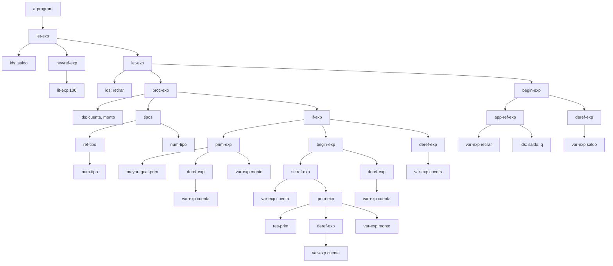
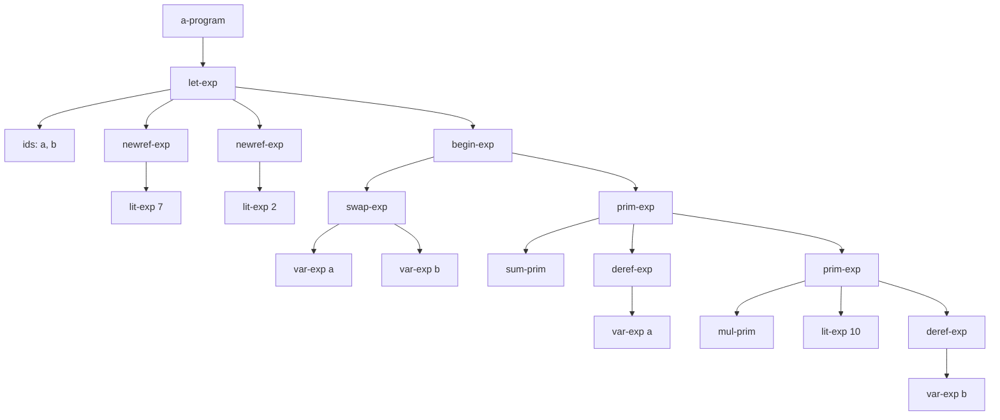
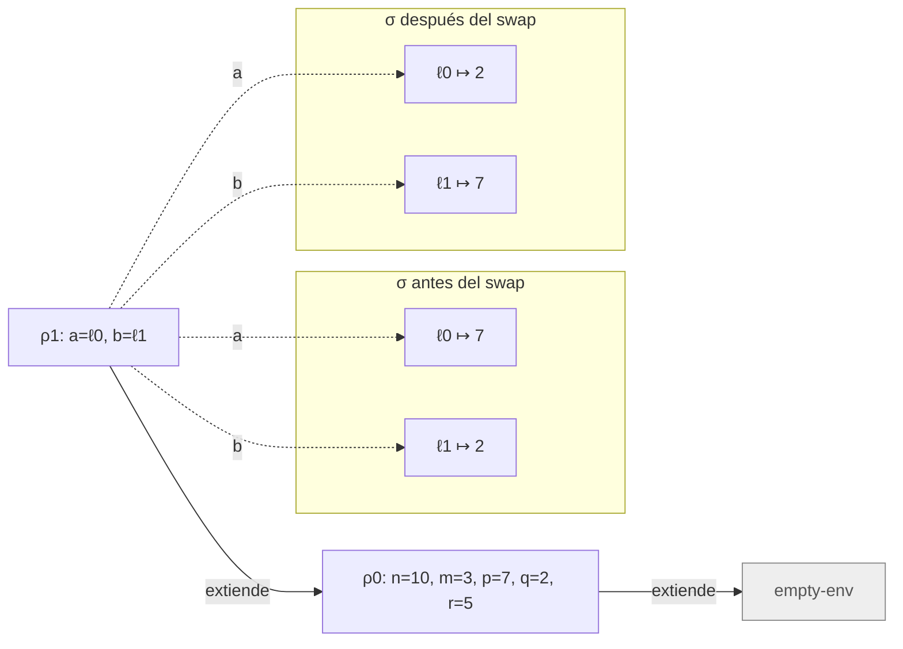

# Informe de AST — Taller 3: Memoria y disciplina (Parte 4)
 
**Curso:** Fundamentos de Interpretación y Compilación de Lenguajes
de Programación — Universidad del Valle, Sede Tuluá.
 
**Integrantes del grupo:**
 
| Nombre | Código | Correo institucional |
|--------|--------|----------------------|
| Juan Sebastian Navarrete | 202459562 | juan.sebastian.navarrete@correounivalle.edu.co |
| Samuel García Parra | 202459476 | samuel.parra@correounivalle.edu.co |
 
---
 
## 1. Gramática considerada
 
Gramática de Cauca con referencias y tipos (la del Taller 2 más las
expresiones del almacén y las anotaciones de tipo), tal como está en
`src/sintaxis.rkt`.
 
```bnf
<programa>   ::= <expresion>
                 a-program(body)
 
<expresion>  ::= <numero>                                   lit-exp(n)
             ::= <identificador>                            var-exp(id)
             ::= "true"                                     true-exp()
             ::= "false"                                    false-exp()
             ::= <primitiva> "(" {<expresion>}*(,) ")"      prim-exp(prim, rands)
             ::= "if" <expresion> "then" <expresion>
                 "else" <expresion> "end"                   if-exp(cond, then, else)
             ::= "let" {<identificador> "=" <expresion>}*
                 "in" <expresion> "end"                     let-exp(ids, exps, body)
             ::= "proc" "(" {<identificador> ":" <tipo>}*(,) ")"
                 <expresion> "end"                          proc-exp(ids, tipos, body)
             ::= "apply" <expresion> "(" {<expresion>}*(,) ")"
                                                            app-exp(rator, rands)
             ::= "letrec" {<tipo> <identificador>
                 "(" {<identificador> ":" <tipo>}*(,) ")"
                 "=" <expresion>}* "in" <expresion> "end"
                   letrec-exp(tipos-res, proc-names, idss, tipos-args, bodies, body)
             ::= "case" <expresion> {"of" <numero> "=>" <expresion>}*
                 "otherwise" "=>" <expresion> "end"         case-exp(e, nums, exps, default)
             ::= "newref" "(" <expresion> ")"               newref-exp(exp)
             ::= "deref" "(" <expresion> ")"                deref-exp(exp)
             ::= "setref" "(" <expresion> "," <expresion> ")"
                                                            setref-exp(ref, exp)
             ::= "swap" "(" <expresion> "," <expresion> ")" swap-exp(ref1, ref2)
             ::= "begin" <expresion> {";" <expresion>}* "end"
                                                            begin-exp(exp, exps)
             ::= "applyref" <expresion>
                 "(" {<identificador>}*(,) ")"              app-ref-exp(rator, ids)
 
<tipo>       ::= "num"                                      num-tipo()
             ::= "bool"                                     bool-tipo()
             ::= "refto" "(" <tipo> ")"                     ref-tipo(t)
             ::= "(" {<tipo>}*(*) "->" <tipo> ")"           proc-tipo(args, res)
 
<primitiva>  ::= "+" | "-" | "*" | "add1" | "sub1" | ">" | "<" | ">=" | "<="
                 | "==" | "and" | "or" | "not" | "entre"
                 (sum-prim, res-prim, mul-prim, add1-prim, sub1-prim, mayor-prim,
                  menor-prim, mayor-igual-prim, menor-igual-prim, igual-prim,
                  and-prim, or-prim, not-prim, entre-prim)
```
 
Los identificadores que aparecen en `let-exp`, `proc-exp` y `app-ref-exp`
son símbolos (hojas del árbol), no `var-exp`.
 
---
 
## 2. Ejemplos de AST
 
### Ejemplo 1 — Cuenta de saldo con `applyref` (4.1)
 
**Expresión concreta:**
 
```scheme
let saldo = newref(100)
in
  let retirar = proc (cuenta : refto(num), monto : num)
                  if >=(deref(cuenta), monto)
                  then begin
                         setref(cuenta, -(deref(cuenta), monto));
                         deref(cuenta)
                       end
                  else deref(cuenta)
                  end
                end
  in
    begin
      applyref retirar (saldo, q);
      deref(saldo)
    end
  end
end
```
 
**AST (incluye los nodos de tipo):**
 

 
**Explicación:** la raíz es `a-program`, que envuelve dos `let-exp`
anidados. El primero liga `saldo` a `newref-exp(lit-exp 100)`. El segundo
liga `retirar` a un `proc-exp` con dos parámetros: sus anotaciones cuelgan
del nodo `tipos` (`ref-tipo(num-tipo)` para `cuenta` y `num-tipo` para
`monto`) y su cuerpo es un `if-exp`. La condición es un `prim-exp` con
`mayor-igual-prim` sobre `deref-exp(var-exp cuenta)` y `var-exp monto`; la
rama `then` es un `begin-exp` con un `setref-exp` (cuyo valor es otro
`prim-exp` de resta) seguido de `deref-exp`; la rama `else` es un
`deref-exp`. El cuerpo del segundo `let-exp` es un `begin-exp` cuya primera
expresión es `app-ref-exp` (operador `var-exp retirar`, argumentos `saldo` y
`q` como identificadores) y cuya última es `deref-exp(var-exp saldo)`.
 
**Por qué no pasa el chequeador.** Con el ambiente de tipos inicial
$\Gamma_0 = [n, m, p, q, r \mapsto \texttt{num}]$ se tiene
$\Gamma(\texttt{q}) = \texttt{num}$. La regla de `applyref` exige que cada
argumento $x_i$ cumpla $\Gamma(x_i) = t_i$ con $t_i = \texttt{refto}(s_i)$:
 
$$
\frac{\Gamma \vdash f : (t_1 * \cdots * t_n \to t)
\qquad \Gamma(x_i) = t_i
\qquad t_i = \texttt{refto}(s_i)}
{\Gamma \vdash \texttt{applyref } f(x_1, \ldots, x_n) : t}
$$
 
Para el segundo argumento, $\Gamma(\texttt{q}) = \texttt{num}$ no es de la
forma $\texttt{refto}(s)$, así que la regla no aplica y el chequeador
rechaza el programa con `applyref exige variables de tipo refto(t), q es num`.
Aun sin chequeador, el intérprete también fallaría: `q` está ligado a `2`,
no a una referencia, y `applyref` exige variables ligadas a referencias.
 
**Corrección mínima.** Se cambia `monto` a `refto(num)` y se pasa una celda
creada con el valor de `q`. El cuerpo lee `deref(monto)` donde antes usaba
`monto`:
 
```scheme
let saldo = newref(100)
in
  let retirar = proc (cuenta : refto(num), monto : refto(num))
                  if >=(deref(cuenta), deref(monto))
                  then begin
                         setref(cuenta, -(deref(cuenta), deref(monto)));
                         deref(cuenta)
                       end
                  else deref(cuenta)
                  end
                end
  in
    let m = newref(q)
    in
      begin
        applyref retirar (saldo, m);
        deref(saldo)
      end
    end
  end
end
```
 
Ahora $\Gamma(\texttt{saldo}) = \Gamma(\texttt{m}) = \texttt{refto(num)}$, que
coincide con los tipos de los parámetros, y el programa tiene tipo `num`.
(Con `applyref` el parámetro queda ligado a la misma celda, de modo que el
`setref` sobre `cuenta` sí se ve en `saldo`: el resultado es $98$.)
 
---
 
### Ejemplo 2 — El `let` con `newref` y `begin` (swap, 4.2)
 
**Expresión concreta:**
 
```scheme
let a = newref(7)
    b = newref(2)
in
  begin
    swap(a, b);
    +(deref(a), *(10, deref(b)))
  end
end
```
 
**AST:**
 

 
**Explicación:** un único `let-exp` con dos ligaduras, cada una un
`newref-exp` sobre un `lit-exp`. Su cuerpo es un `begin-exp` con dos
expresiones: `swap-exp` sobre dos `var-exp` y un `prim-exp` de suma cuyo
segundo operando es otro `prim-exp` (producto). Este programa no lleva
anotaciones de tipo, así que no aparecen nodos de tipo.
 
---
 
## 3. Traza de evaluación con el estado del almacén (4.2)
 
El enunciado pide la traza del `swap` como tabla de cuatro columnas; el
estado del almacén se escribe $\sigma = [\,0 \mapsto v_0,\ 1 \mapsto v_1,\ \ldots\,]$.
 
**Expresión a evaluar:** la del Ejemplo 2 (resultado esperado: $72$).
 
**Ambientes:**
 
- $\rho_0 = [\,n = 10,\ m = 3,\ p = 7,\ q = 2,\ r = 5\,]$ (ambiente inicial).
- $\rho_1 = [\,a = \ell_0,\ b = \ell_1\,]$, que extiende a $\rho_0$.
- $\ell_0$ y $\ell_1$ son las referencias `a-ref(0)` y `a-ref(1)`.
- $\sigma_0 = [\,]$ (el almacén empieza vacío: `initialize-store!`).
**Tabla de la traza** (el almacén se muestra antes → después de evaluar la expresión):
 
| # | Expresión evaluada | Ambiente | Estado del almacén | Valor resultante |
|---|--------------------|----------|--------------------|------------------|
| 1 | `let a = newref(7) b = newref(2) in … end` | $\rho_0$ | $\sigma = [\,]$ → $[\,0 \mapsto 2,\ 1 \mapsto 7\,]$ | $72$ |
| 2 | `newref(7)` | $\rho_0$ | $[\,] \to [\,0 \mapsto 7\,]$ | $\ell_0$ |
| 3 | `newref(2)` | $\rho_0$ | $[\,0 \mapsto 7\,] \to [\,0 \mapsto 7,\ 1 \mapsto 2\,]$ | $\ell_1$ |
| 4 | `begin swap(a, b); +(deref(a), *(10, deref(b))) end` | $\rho_1$ | $[\,0 \mapsto 7,\ 1 \mapsto 2\,] \to [\,0 \mapsto 2,\ 1 \mapsto 7\,]$ | $72$ |
| 5 | `a`, `b` (dentro del `swap`) | $\rho_1$ | $[\,0 \mapsto 7,\ 1 \mapsto 2\,]$ | $\ell_0$, $\ell_1$ |
| 6 | `swap(a, b)` | $\rho_1$ | $[\,0 \mapsto 7,\ 1 \mapsto 2\,] \to [\,0 \mapsto 2,\ 1 \mapsto 7\,]$ | $2$ (contenido anterior de $\ell_1$) |
| 7 | `deref(a)` | $\rho_1$ | $[\,0 \mapsto 2,\ 1 \mapsto 7\,]$ | $2$ |
| 8 | `deref(b)` | $\rho_1$ | $[\,0 \mapsto 2,\ 1 \mapsto 7\,]$ | $7$ |
| 9 | `*(10, deref(b))` | $\rho_1$ | $[\,0 \mapsto 2,\ 1 \mapsto 7\,]$ | $70$ |
| 10 | `+(deref(a), *(10, deref(b)))` | $\rho_1$ | $[\,0 \mapsto 2,\ 1 \mapsto 7\,]$ | $2 + 70 = 72$ |
 
Notas sobre la evaluación:
 
- `let-exp` evalúa las expresiones de las ligaduras en $\rho_0$, de izquierda
  a derecha; por eso `a` queda en la posición 0 y `b` en la 1.
- `swap` lee ambos contenidos ($v_1 = 7$, $v_2 = 2$) antes de escribir,
  escribe $v_2$ en $\ell_0$ y $v_1$ en $\ell_1$, y retorna $v_2$.
- `begin` descarta el valor del `swap` (el $2$) y retorna el de la última
  expresión.
**Diagrama: cadena de ambientes y dos instantáneas del almacén.** Las
flechas punteadas muestran la referencia a la que apunta cada nombre en cada
instantánea.
 

 
Las referencias $\ell_0$ y $\ell_1$ no cambian: lo que cambia es el contenido
de las celdas. Por eso `swap` intercambia contenidos y no referencias.
 
**Versión con `apply` (Parte 2).** El enunciado pide además explicar qué da
el programa de contraste cuando se usa `apply` en lugar de `applyref`:
 
```scheme
let x = newref(11)
    y = newref(4)
in
  let intercambiar = proc (u : refto(num), v : refto(num))
                       swap(u, v)
                     end
  in
    begin
      apply intercambiar (x, y);
      -(deref(x), deref(y))
    end
  end
end
```
 
Con `apply`, cada argumento que es referencia se copia (`copia-por-valor`
reserva una celda nueva con el mismo contenido): `u` y `v` quedan ligados a
las celdas $\ell_2$ y $\ell_3$, no a $\ell_0$ y $\ell_1$. El `swap` intercambia
$\ell_2$ y $\ell_3$, y las celdas de `x` y `y` quedan intactas
($\sigma = [\,0 \mapsto 11,\ 1 \mapsto 4,\ 2 \mapsto 4,\ 3 \mapsto 11\,]$),
así que el resultado es $11 - 4 = 7$. Con `applyref`, `u` y `v` comparten
$\ell_0$ y $\ell_1$, el intercambio se ve afuera y el resultado es
$4 - 11 = -7$.
 
---
 
## 4. Estado del almacén en una transacción
 
No aplica: Cauca no tiene bloques transaccionales (`atomic`) y el enunciado
de este taller no pide esta sección. Se conserva el encabezado para no
alterar la estructura de la plantilla.
 
---
 
## 5. Referencias
 
- Friedman, D. P., & Wand, M. *Essentials of Programming Languages*,
  3.ª ed., MIT Press, 2008. Secciones 2.5 (ASTs), 2.2 (ambientes),
  4.2 (EXPLICIT-REFS), 4.3 (paso por referencia) y 7.1–7.3 (chequeo de
  tipos).
- Pierce, B. C. *Types and Programming Languages*, MIT Press, 2002.
  Capítulos 8 y 13.
 