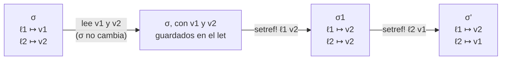

# Informe de corrección — Taller 3: Memoria y disciplina

**Curso:** Fundamentos de Interpretación y Compilación de Lenguajes
de Programación — Universidad del Valle, Sede Tuluá.

**Integrantes del grupo:**

| Nombre | Código | Correo institucional |
|--------|--------|----------------------|
| {{Nombre 1}} | {{Código 1}} | {{correo1@correounivalle.edu.co}} |
| {{Nombre 2}} | {{Código 2}} | {{correo2@correounivalle.edu.co}} |

**Dónde está cada punto de la Parte 5 del enunciado:**

| Punto del enunciado | Dónde se demuestra |
|---|---|
| 5.1 El almacén preserva su invariante | Sección 1.3 (definición), 2.1 a 2.4 (una operación por subsección) y 3.1 (teorema) |
| 5.2 Corrección de `swap` | Sección 2.5 |
| 5.3 Solidez del chequeador | Sección 3.2 |

---

## 1. Marco formal

### 1.1 Corrección de programas recursivos

Sea $f : A \to B$ una función y $A$ un conjunto definido
recursivamente. Sea $P_f$ un programa recursivo en Racket que
pretende calcular $f$. Decimos que $P_f$ es correcto con respecto a
su especificación si se cumple:

$$
\forall a \in A \,:\, P_f(a) = f(a)
$$

La estrategia de demostración es la **inducción estructural**
sobre $A$:

- **Caso base:** para cada valor básico $a_0 \in A$ se verifica
  $P_f(a_0) = f(a_0)$.
- **Caso inductivo:** asumiendo la **hipótesis de inducción**
  $P_f(a') = f(a')$ para las subestructuras $a'$ que forman $a$, se
  demuestra $P_f(a) = f(a)$.

### 1.2 Corrección de programas iterativos

Para un programa iterativo se formalizan:

- Un estado $s$ con componentes relevantes.
- Un estado inicial $s_0$.
- Un estado final reconocido por un predicado $\text{es-final?}(s)$.
- Una **invariante** $\text{Inv}(s)$ que se mantiene entre pasos.
- Una transformación $\text{transformar}(s)$.

La corrección se argumenta demostrando:

1. $\text{Inv}(s_0)$ se cumple al inicio.
2. $\text{Inv}(s) \,\land\, \lnot\text{es-final?}(s)\Rightarrow
   \text{Inv}(\text{transformar}(s))$.
3. $\text{Inv}(s) \,\land\, \text{es-final?}(s)\Rightarrow
   \text{respuesta}(s) = f(\text{entrada})$.
4. El proceso termina (argumentar una función de cota estrictamente
   decreciente sobre $\mathbb{N}$).

### 1.3 Marco de este taller: el almacén

De las funciones de este informe, solo `replace-nth` es recursiva y se
trata con 1.1. El resto no tiene recursión: son operaciones que cambian
un estado global, y se demuestran razonando sobre ese estado antes y
después, en el espíritu de la invariante de 1.2.

**Convenciones.** Un almacén es una secuencia finita de valores
$\sigma = [v_0, v_1, \dots, v_{n-1}]$. Su longitud es
$\lvert \sigma \rvert = n$, su dominio es
$\mathrm{dom}(\sigma) = \{0, \dots, n-1\}$ y $\sigma(i)$ es el contenido
de la celda $i$. Una referencia $\mathtt{(a\text{-}ref}\ \ell\mathtt{)}$ se
escribe simplemente $\ell$.

**Las operaciones**, vistas como funciones sobre almacenes. El módulo
`almacen.rkt` guarda $\sigma$ en la variable global `the-store`, una lista.

| Operación | Efecto sobre $\sigma$ | Resultado |
|---|---|---|
| `initialize-store!` | $\sigma' = [\,]$ | `void` |
| `newref!`$(\sigma, v)$ | $\sigma' = \mathrm{append}(\sigma, [v])$ | la referencia $\lvert \sigma \rvert$ |
| `setref!`$(\sigma, \ell, v)$ | $\sigma' = \texttt{replace-nth}(\sigma, \ell, v)$ | `void` |
| `deref`$(\sigma, \ell)$ | $\sigma' = \sigma$ | $\sigma(\ell)$ |

**Variable fantasma.** Para enunciar la primera condición del
invariante hay que saber qué referencias se han entregado. Eso no está
en el código, así que lo modelamos con un conjunto $R$: las posiciones
que `newref!` ha entregado desde el último `initialize-store!`. Al
inicializar, $R = \emptyset$, y `newref!` agrega a $R$ la posición que
retorna. Un **estado** del almacén es el par $(\sigma, R)$.

**El invariante.**

$$
\mathrm{Inv}(\sigma, R) \;\equiv\; R \subseteq \mathrm{dom}(\sigma) \qquad \text{(I1)}
$$

Las otras tres condiciones del enunciado hablan de lo que una operación
hace al pasar de $\sigma$ a $\sigma'$. Forman el **contrato de
transición** que cada operación debe cumplir:

- **(I2)** El almacén solo crece por `newref!`: $\lvert \sigma' \rvert = \lvert \sigma \rvert + 1$ si la operación es `newref!`, y $\lvert \sigma' \rvert = \lvert \sigma \rvert$ en cualquier otro caso.
- **(I3)** Si $\sigma' = \texttt{setref!}(\sigma, \ell, v)$, entonces $\sigma'(\ell) = v$ y $\sigma'(\ell') = \sigma(\ell')$ para todo $\ell' \neq \ell$.
- **(I4)** `deref` sobre una referencia fuera de rango levanta `eopl:error`.

Una operación **preserva el invariante** si, partiendo de un estado con
$\mathrm{Inv}(\sigma, R)$, el estado resultante cumple
$\mathrm{Inv}(\sigma', R')$ y la transición cumple las cláusulas (I2) a
(I4) que le corresponden.

---

## 2. Funciones analizadas

### 2.1 Corrección de `replace-nth`

**Especificación.**

- **Tipo:** `replace-nth : lista x entero x valor -> lista`
- **Pre-condición:** $\text{Pre}(L, k, v) \equiv 0 \le k < \lvert L \rvert$.
- **Post-condición:** $\text{Post}(L, k, v, r) \equiv \lvert r \rvert = \lvert L \rvert \,\land\, r(k) = v \,\land\, \forall i \neq k \,:\, r(i) = L(i)$.

**Código.**

```racket
; replace-nth : lista x entero x valor -> lista
; Propósito: retorna una lista igual a lst salvo en la posición n,
;            que queda con val.
(define replace-nth
  (lambda (lst n val)
    (if (= n 0)
        (cons val (cdr lst))
        (cons (car lst) (replace-nth (cdr lst) (- n 1) val)))))
```

**Estrategia de demostración:** inducción estructural sobre $k$, que
en cada llamada recursiva decrece en uno mientras la lista pierde su
primer elemento.

**Demostración.**

- **Caso base** ($k = 0$). Como $\lvert L \rvert > 0$, $L$ no es vacía y
  `replace-nth` retorna $\texttt{cons}(v, \texttt{cdr}\ L)$. Entonces
  $\lvert r \rvert = 1 + (\lvert L \rvert - 1) = \lvert L \rvert$, $r(0) = v$
  y, para $i \ge 1$, $r(i) = (\texttt{cdr}\ L)(i-1) = L(i)$.

- **Caso inductivo** ($k > 0$). Asumimos la hipótesis de inducción para
  $k-1$ sobre $\texttt{cdr}\ L$, que tiene longitud
  $\lvert L \rvert - 1 > k - 1 \ge 0$, así que la precondición se
  cumple. Sea $L'' = \texttt{replace-nth}(\texttt{cdr}\ L,\ k-1,\ v)$.
  Por hipótesis, $\lvert L'' \rvert = \lvert L \rvert - 1$,
  $L''(k-1) = v$ y $L''(j) = L(j+1)$ para $j \neq k-1$. El resultado es
  $r = \texttt{cons}(\texttt{car}\ L,\ L'')$, de modo que:
  - $\lvert r \rvert = 1 + (\lvert L \rvert - 1) = \lvert L \rvert$.
  - $r(0) = L(0)$, y $0 \neq k$.
  - Para $i \ge 1$, $r(i) = L''(i-1)$. Si $i = k$, vale $v$. Si $i \neq k$, vale $L(i)$.

- **Terminación.** La medida es $k \in \mathbb{N}$: cada llamada recursiva
  usa $k-1$, y la precondición $k < \lvert L \rvert$ garantiza que la lista
  no se agota antes de llegar a $k = 0$. Está acotada inferiormente por $0$.

**Conclusión:** para toda entrada que cumple $\text{Pre}$, se cumple
$\text{Post}$. Por lo tanto `replace-nth` es correcta respecto a su
especificación. $\blacksquare$

---

### 2.2 Corrección de `newref!`

**Especificación.**

- **Tipo:** `newref! : valor -> referencia` (modifica `the-store`).
- **Pre-condición:** $\mathrm{Inv}(\sigma, R)$.
- **Post-condición:** $\sigma' = \mathrm{append}(\sigma, [v])$, el resultado es $\ell = \lvert \sigma \rvert$, $R' = R \cup \{\ell\}$ y se cumple $\mathrm{Inv}(\sigma', R')$.

**Código.**

```racket
; newref! : valor -> referencia
; Propósito: agrega una celda al final del almacén con el valor dado
;            y retorna su referencia.
(define newref!
  (lambda (val)
    (let ((next-pos (length the-store)))
      (set! the-store (append the-store (list val)))
      (a-ref next-pos))))
```

**Estrategia de demostración:** razonamiento directo sobre el estado
antes y después. No hay recursión.

**Demostración.** Sea $\ell = \lvert \sigma \rvert$ el valor de `next-pos`.

- **Agrega exactamente una celda (I2).** $\lvert \sigma' \rvert = \lvert \sigma \rvert + 1$.
- **No altera las celdas existentes.** $\sigma'(i) = \sigma(i)$ para todo $i < \lvert \sigma \rvert$, y $\sigma'(\ell) = v$.
- **La referencia es válida.** $\ell = \lvert \sigma \rvert < \lvert \sigma' \rvert$, así que $\ell \in \mathrm{dom}(\sigma')$.
- **(I1) se preserva.** $R' = R \cup \{\ell\}$. Por hipótesis $R \subseteq \mathrm{dom}(\sigma) \subseteq \mathrm{dom}(\sigma')$, y además $\ell \in \mathrm{dom}(\sigma')$.

**Terminación.** No hay recursión. `length` y `append` terminan sobre
listas finitas.

**Conclusión:** `newref!` cumple su especificación y preserva el invariante. $\blacksquare$

---

### 2.3 Corrección de `setref!`

**Especificación.**

- **Tipo:** `setref! : referencia x valor -> void` (modifica `the-store`).
- **Pre-condición:** $\mathrm{Inv}(\sigma, R)$.
- **Post-condición:** si $\ell \in \mathrm{dom}(\sigma)$, entonces $\sigma'(\ell) = v$, $\sigma'(\ell') = \sigma(\ell')$ para todo $\ell' \neq \ell$, $\lvert \sigma' \rvert = \lvert \sigma \rvert$ y $\mathrm{Inv}(\sigma', R)$. Si $\ell \notin \mathrm{dom}(\sigma)$, levanta `eopl:error` y $\sigma$ no cambia.

**Código.**

```racket
; setref! : referencia x valor -> void
; Propósito: escribe val en la celda indicada. Fuera de rango, error.
(define setref!
  (lambda (ref val)
    (cases referencia ref
      (a-ref (pos)
        (if (and (>= pos 0) (< pos (length the-store)))
            (set! the-store (replace-nth the-store pos val))
            (eopl:error 'setref! "Referencia fuera de rango: ~s" pos))))))
```

**Estrategia de demostración:** razonamiento directo sobre el estado,
apoyado en la corrección de `replace-nth` (2.1). El `set!` solo reasigna
`the-store`; el reemplazo en sí lo hace `replace-nth`, que es puro.

**Demostración.** La verificación de rango precede a la escritura.

- **Caso $\ell \notin \mathrm{dom}(\sigma)$.** Se levanta el error y el `set!` nunca se ejecuta, así que $\sigma$ no cambia y el invariante se conserva trivialmente.
- **Caso $\ell \in \mathrm{dom}(\sigma)$.** Se cumple la precondición de `replace-nth` con $L = \sigma$ y $k = \ell$. Por 2.1:
  - **(I2).** $\lvert \sigma' \rvert = \lvert \sigma \rvert$.
  - **(I3), la celda indicada.** $\sigma'(\ell) = v$.
  - **(I3), las demás.** Para todo $\ell' \neq \ell$, $\sigma'(\ell') = \sigma(\ell')$. Es exactamente la formalización del enunciado: se modifica **una sola** celda y las demás conservan su valor.
  - **(I1).** $R' = R$ y $\mathrm{dom}(\sigma') = \mathrm{dom}(\sigma)$, así que $R' \subseteq \mathrm{dom}(\sigma')$.

**Terminación.** Sin recursión propia: `replace-nth` termina por 2.1.

**Conclusión:** `setref!` cumple su especificación y preserva el invariante. $\blacksquare$

---

### 2.4 Corrección de `deref`

**Especificación.**

- **Tipo:** `deref : referencia -> valor`.
- **Pre-condición:** $\mathrm{Inv}(\sigma, R)$.
- **Post-condición:** si $\ell \in \mathrm{dom}(\sigma)$, retorna $\sigma(\ell)$ y $(\sigma', R') = (\sigma, R)$. Si $\ell \notin \mathrm{dom}(\sigma)$, levanta `eopl:error`.

**Código.**

```racket
; deref : referencia -> valor
; Propósito: lee el contenido de la celda. Fuera de rango, error.
(define deref
  (lambda (ref)
    (cases referencia ref
      (a-ref (pos)
        (if (and (>= pos 0) (< pos (length the-store)))
            (list-ref the-store pos)
            (eopl:error 'deref "Referencia fuera de rango: ~s" pos))))))
```

**Estrategia de demostración:** razonamiento directo. El cuerpo solo
contiene la verificación de rango y `list-ref`: **no ejecuta ningún
`set!`**.

**Demostración.** Como no hay escrituras, $\sigma' = \sigma$ y $R' = R$:

- **(I1)** se conserva porque el estado no cambia.
- **(I2)** se cumple: $\lvert \sigma' \rvert = \lvert \sigma \rvert$.
- **(I3)** no aplica, porque `deref` no escribe.
- **(I4).** Si $\ell < 0$ o $\ell \ge \lvert \sigma \rvert$, la guarda del `if` falla y se levanta `eopl:error`. Si $\ell \in \mathrm{dom}(\sigma)$, `list-ref` retorna $\sigma(\ell)$.

**Terminación.** Sin recursión. `length` y `list-ref` terminan sobre listas finitas.

**Conclusión:** `deref` cumple su especificación y no modifica el almacén. $\blacksquare$

---

### 2.5 Corrección de `swap-exp` (cláusula de `evaluar-expresion`)

**Especificación.**

- **Tipo:** `swap-exp : expresion x expresion x ambiente -> valor` (modifica `the-store`).
- **Pre-condición:** $\mathrm{Inv}(\sigma, R)$. Sean $\ell_1$ y $\ell_2$ las posiciones de las referencias a las que evalúan `e1` y `e2`, y sea $\sigma$ el almacén **justo después de evaluar `e1` y `e2`**. Es el almacén que `swap` ve al empezar, y puede ser distinto del de antes si esas expresiones tuvieron efectos. Como las referencias salieron de `newref!`, (I1) garantiza $\ell_1, \ell_2 \in \mathrm{dom}(\sigma)$.
- **Post-condición** (la especificación del enunciado):

$$
\sigma'(\ell_1) = \sigma(\ell_2), \qquad \sigma'(\ell_2) = \sigma(\ell_1), \qquad \sigma'(\ell) = \sigma(\ell)\ \text{ para toda } \ell \notin \{\ell_1, \ell_2\},
$$

  y el valor retornado es $\sigma(\ell_2)$, el contenido anterior de la segunda celda.

**Código.**

```racket
; swap-exp : expresion x expresion x ambiente -> valor
; Propósito: intercambia el contenido de dos celdas y retorna el
;            contenido anterior de la segunda.
(swap-exp (e1 e2)
  (let* ((r1 (evaluar-expresion e1 env))
         (r2 (evaluar-expresion e2 env)))
    (if (and (referencia? r1) (referencia? r2))
        (let ((v1 (deref r1))
              (v2 (deref r2)))
          (setref! r1 v2)
          (setref! r2 v1)
          v2)
        (eopl:error 'swap "Se esperaban dos referencias, se recibio ~s y ~s" r1 r2))))
```

La implementación hace, en este orden: (1) lee $v_1 = \sigma(\ell_1)$ y
$v_2 = \sigma(\ell_2)$ con `deref`, que no cambia el almacén (2.4);
(2) $\sigma_1 = \texttt{setref!}(\sigma, \ell_1, v_2)$;
(3) $\sigma' = \texttt{setref!}(\sigma_1, \ell_2, v_1)$; (4) retorna $v_2$.
Si algún operando no es una referencia, se levanta el error **antes** de
cualquier escritura y el almacén queda intacto.



**Estrategia de demostración:** razonamiento sobre el estado, usando
la corrección de `setref!` (2.3) y de `deref` (2.4). Se distinguen los
casos $\ell_1 \neq \ell_2$ y $\ell_1 = \ell_2$.

**Demostración.**

- **Caso general ($\ell_1 \neq \ell_2$).** Por 2.3, después del primer `setref!`:

  $$
  \lvert \sigma_1 \rvert = \lvert \sigma \rvert, \qquad \sigma_1(\ell_1) = v_2, \qquad \sigma_1(\ell) = \sigma(\ell)\ \text{ para } \ell \neq \ell_1.
  $$

  Y después del segundo:

  $$
  \lvert \sigma' \rvert = \lvert \sigma_1 \rvert, \qquad \sigma'(\ell_2) = v_1, \qquad \sigma'(\ell) = \sigma_1(\ell)\ \text{ para } \ell \neq \ell_2.
  $$

  Entonces:
  - **Celda $\ell_1$.** Como $\ell_1 \neq \ell_2$, $\sigma'(\ell_1) = \sigma_1(\ell_1) = v_2 = \sigma(\ell_2)$. ✓
  - **Celda $\ell_2$.** $\sigma'(\ell_2) = v_1 = \sigma(\ell_1)$. ✓
  - **Las demás.** Si $\ell \notin \{\ell_1, \ell_2\}$, entonces $\sigma'(\ell) = \sigma_1(\ell) = \sigma(\ell)$. ✓

  La longitud no cambia, así que el invariante se conserva (I1 e I2).

- **El valor original de la primera celda no se pierde.** Después del primer `setref!`, la celda $\ell_1$ ya contiene $v_2$, y $v_1$ solo existe en la variable local `v1` del `let`. Por eso se leen ambos valores **antes** de escribir. La versión ingenua falla:

  ```racket
  (setref! r1 (deref r2))
  (setref! r2 (deref r1))   ; aquí deref r1 ya devuelve v2, no v1
  ```

  Con ella, $\sigma_1(\ell_1) = v_2$ y la segunda lectura devuelve $v_2$, así que ambas celdas quedarían con $v_2$ y $v_1$ se perdería.

- **Caso $\ell_1 = \ell_2 = \ell$.** *Qué exige la especificación:* las dos primeras igualdades dicen $\sigma'(\ell) = \sigma(\ell)$, la misma condición escrita dos veces, así que no se contradicen. La tercera dice que las demás celdas no cambian. Juntas exigen $\sigma' = \sigma$: intercambiar una celda consigo misma no hace nada. *Qué hace la implementación:* $v_1 = v_2 = \sigma(\ell)$. El primer `setref!` escribe $\sigma(\ell)$ en $\ell$, así que $\sigma_1(\ell) = \sigma(\ell)$ y las demás celdas y la longitud no cambian. Dos secuencias con la misma longitud y los mismos elementos en cada posición son iguales, luego $\sigma_1 = \sigma$. El segundo `setref!` repite el argumento y da $\sigma' = \sigma_1 = \sigma$. ✓

- **Valor retornado.** La implementación retorna $v_2$, y $v_2 = \sigma(\ell_2)$ por la lectura del paso 1, hecha antes de cualquier escritura. Es el contenido anterior de la segunda celda. Coincide con la descripción del enunciado ("el valor que quedó en la primera referencia"): si $\ell_1 \neq \ell_2$, $\sigma'(\ell_1) = \sigma(\ell_2) = v_2$; si $\ell_1 = \ell_2$, $\sigma'(\ell_1) = \sigma(\ell_1) = \sigma(\ell_2) = v_2$.

- **Terminación.** No hay recursión propia. Se asume que la evaluación de `e1` y `e2` termina, y `deref` y `setref!` terminan por 2.4 y 2.3.

**Conclusión:** la implementación de `swap-exp` satisface la
especificación en todos los casos, retorna el contenido anterior de la
segunda celda y preserva el invariante. $\blacksquare$

---

## 3. Propiedades adicionales

### 3.1 Invariante del almacén

**Enunciado.** Con $\mathrm{Inv}$ y el contrato (I2) a (I4) de la sección
1.3: si $\sigma' = \text{setref!}(\sigma, \ell, v)$, entonces
$\sigma'(\ell) = v$ y $\sigma'(\ell') = \sigma(\ell')$ para todo
$\ell' \neq \ell$. La operación que reserva una celda (`newref!`) es la
única que cambia la longitud del almacén.

**Teorema 1.** $\mathrm{Inv}(\sigma, R)$ vale en todo estado alcanzable.

**Demostración**, por inducción sobre el número de operaciones ejecutadas
desde el último `initialize-store!`.

- *Base.* Tras `initialize-store!`, $\sigma = [\,]$ y $R = \emptyset$, y $\emptyset \subseteq \mathrm{dom}([\,]) = \emptyset$.
- *Paso.* Si $\mathrm{Inv}(\sigma, R)$ vale antes de una operación, las secciones 2.2, 2.3 y 2.4 muestran que `newref!`, `setref!` y `deref` dejan un estado con $\mathrm{Inv}(\sigma', R')$ y cumplen el contrato (I2) a (I4). $\blacksquare$

**Corolario.** Un programa de Cauca no puede fabricar una referencia por su
cuenta: `a-ref` es un tipo abstracto y la gramática no tiene ninguna forma
de construirlo. Por eso toda referencia que circula en una ejecución
pertenece a $R$. Junto con (I1), la rama de error de `deref` y de `setref!`
no se alcanza con referencias que el propio programa produjo. Además,
`evaluar-programa` llama a `initialize-store!` al empezar, de modo que
ninguna referencia de una ejecución anterior puede aparecer en la
siguiente. La copia por valor (`copia-por-valor`) solo usa `newref!` y
`deref`, así que también preserva el invariante.

---

### 3.2 Solidez del chequeador de tipos

**Alcance.** Trabajamos con el fragmento de Cauca **sin referencias**:
literales, variables, primitivas, `if`, `let`, `proc`, `apply`, `letrec` y
`case`. En él, $\mathrm{value\text{-}of}(e, \rho)$ es una función del
ambiente de valores $\rho$ y no hay almacén. Los únicos valores son
números, booleanos y clausuras, y `copia-por-valor` es la identidad sobre
todos ellos. Como `letrec` permite programas que no terminan, la propiedad
es de **corrección parcial**: si la evaluación termina, el resultado tiene
el tipo previsto, y no se produce ningún error de tipo ni de variable no
ligada.

**Valores de un tipo.** Definimos $v \in \llbracket t \rrbracket$ ("$v$ es
un valor de tipo $t$") por recursión sobre la estructura de $t$:

- $\llbracket \mathtt{num} \rrbracket$ es el conjunto de los números.
- $\llbracket \mathtt{bool} \rrbracket = \{\texttt{\#t}, \texttt{\#f}\}$.
- $\llbracket (t_1 * \cdots * t_n \to t) \rrbracket$ es el conjunto de las clausuras $\mathtt{(closure}\ (x_1 \dots x_n)\ \mathit{body}\ \rho_c\mathtt{)}$ con exactamente $n$ parámetros tales que, **para todos** $v_1 \in \llbracket t_1 \rrbracket, \dots, v_n \in \llbracket t_n \rrbracket$: si la evaluación de $\mathit{body}$ en $\rho_c[x_i \mapsto v_i]$ termina, su resultado pertenece a $\llbracket t \rrbracket$.

La definición es válida porque, para un tipo función, solo menciona los
tipos $t_i$ y $t$, que son estructuralmente más pequeños.

**Concordancia entre $\rho$ y $\Gamma$.** El ambiente de valores $\rho$
*concuerda* con el ambiente de tipos $\Gamma$, y se escribe
$\rho \models \Gamma$, si para todo identificador $x \in \mathrm{dom}(\Gamma)$:

1. $x$ está ligado en $\rho$ (es decir, `apply-env` no falla), y
2. $\rho(x) \in \llbracket \Gamma(x) \rrbracket$.

En palabras: cada variable que $\Gamma$ declara existe en $\rho$ y su valor
es del tipo declarado. $\rho$ puede tener variables de más.

**Lema 2 (extensión).** Si $\rho \models \Gamma$ y
$v_i \in \llbracket t_i \rrbracket$ para $1 \le i \le n$, entonces
$\rho[x_i \mapsto v_i] \models \Gamma[x_i \mapsto t_i]$.

*Demostración.* `apply-env` y `apply-tenv` buscan primero en el marco más
reciente y usan la misma noción de "primera aparición" en la lista de
identificadores. Para $x = x_i$, la búsqueda devuelve $v_i$ en el primero y
$t_i$ en el segundo, y $v_i \in \llbracket t_i \rrbracket$. Para cualquier
otro $x$, ambas búsquedas siguen al ambiente anterior, y se aplica
$\rho \models \Gamma$. $\blacksquare$

**Lema 3 (ambiente inicial).** $\rho_0 \models \Gamma_0$. Es inmediato:
$\rho_0$ liga $n, m, p, q, r$ a $10, 3, 7, 2, 5$, y $\Gamma_0$ los declara
todos como $\mathtt{num}$.

**Teorema 2 (solidez, fragmento sin referencias).**

> Si $\Gamma \vdash e : t$ y $\rho \models \Gamma$, entonces $\mathrm{value\text{-}of}(e, \rho)$ es un valor de tipo $t$ (si la evaluación termina), y no falla con un error de tipo ni de variable no ligada.

Como consecuencia, si `type-of-program` acepta un programa con tipo $t$, la
evaluación de ese programa (en $\rho_0 \models \Gamma_0$, por el Lema 3) da
un valor de tipo $t$.

**Demostración**, por inducción sobre la derivación de
$\Gamma \vdash e : t$. La hipótesis de inducción se aplica a **cualquier**
$\rho'$ y $\Gamma'$ para las subderivaciones: el enunciado está
cuantificado sobre todos los ambientes que concuerdan.

*Casos triviales.*
- *Literal numérico, `true`, `false`.* Evalúan a un número o a un booleano, que son valores de $\mathtt{num}$ y $\mathtt{bool}$.
- *Identificador.* $\Gamma(x) = t$ y $\rho \models \Gamma$ dan directamente $\rho(x) \in \llbracket t \rrbracket$.
- *`let`.* Por hipótesis de inducción cada $e_i$ da $v_i \in \llbracket t_i \rrbracket$. Por el Lema 2, $\rho[x_i \mapsto v_i] \models \Gamma[x_i \mapsto t_i]$, y la hipótesis de inducción sobre el cuerpo da el resultado.

*Caso `if`.* La derivación termina con la regla

$$
\frac{\Gamma \vdash e_1 : \mathtt{bool} \qquad \Gamma \vdash e_2 : t \qquad \Gamma \vdash e_3 : t}{\Gamma \vdash \mathtt{if}\ e_1\ \mathtt{then}\ e_2\ \mathtt{else}\ e_3\ \mathtt{end} : t}
$$

1. Por hipótesis de inducción sobre $e_1$, $\mathrm{value\text{-}of}(e_1, \rho) \in \llbracket \mathtt{bool} \rrbracket = \{\texttt{\#t}, \texttt{\#f}\}$. La comprobación `boolean?` del intérprete pasa, así que no hay error de tipo en la condición.
2. Si el valor es `#t`, el intérprete evalúa $e_2$. Por hipótesis de inducción, el resultado está en $\llbracket t \rrbracket$.
3. Si el valor es `#f`, el intérprete evalúa $e_3$, y la hipótesis de inducción da el mismo tipo $t$.

En ambos casos el resultado está en $\llbracket t \rrbracket$. Esto
justifica que la regla obligue a las dos ramas a tener el mismo tipo: el
chequeador no sabe cuál se ejecutará, y le basta que las dos den $t$.

*Caso `proc`* (lo necesita el caso `apply`). La regla es

$$
\frac{\Gamma[x_i \mapsto t_i] \vdash c : t}{\Gamma \vdash \mathtt{proc}(x_i : t_i)\ c\ \mathtt{end} : (t_1 * \cdots * t_n \to t)}
$$

El intérprete retorna $\mathtt{(closure}\ (x_1 \dots x_n)\ c\ \rho\mathtt{)}$, con
$n$ parámetros. Para ver que esa clausura está en
$\llbracket (t_1 * \cdots * t_n \to t) \rrbracket$, tomemos cualesquiera
$v_i \in \llbracket t_i \rrbracket$. Por el Lema 2,
$\rho[x_i \mapsto v_i] \models \Gamma[x_i \mapsto t_i]$. Por hipótesis de
inducción sobre la subderivación de $c$, si la evaluación del cuerpo
termina, su resultado está en $\llbracket t \rrbracket$.

*Caso `apply`.* La derivación termina con la regla

$$
\frac{\Gamma \vdash f : (t_1 * \cdots * t_n \to t) \qquad \Gamma \vdash e_i : t_i}{\Gamma \vdash \mathtt{apply}\ f(e_1, \dots, e_n) : t}
$$

1. Por hipótesis de inducción sobre $f$, $\mathrm{value\text{-}of}(f, \rho) \in \llbracket (t_1 * \cdots * t_n \to t) \rrbracket$. Por la definición, es una clausura con exactamente $n$ parámetros, así que la comprobación `procval?` del intérprete pasa.
2. Por hipótesis de inducción sobre cada $e_i$, se obtienen $v_i \in \llbracket t_i \rrbracket$ para $1 \le i \le n$. Hay exactamente $n$ argumentos, así que la comprobación de aridad de `apply-procedure` pasa.
3. En este fragmento los valores son números, booleanos y clausuras, y `copia-por-valor` los deja iguales. Los parámetros quedan ligados a $v_1, \dots, v_n$ tal cual.
4. Como los $v_i$ están en $\llbracket t_i \rrbracket$, la definición de $\llbracket (t_1 * \cdots * t_n \to t) \rrbracket$ da directamente: si la evaluación del cuerpo termina, su resultado está en $\llbracket t \rrbracket$. $\blacksquare$

**Observación sobre `letrec`, `case` y primitivas.** Las primitivas y `case`
se tratan como `if`, usando las tablas de tipos de `tipo-de-primitiva`. El
caso `letrec` es más delicado porque la clausura de un procedimiento
recursivo contiene al propio ambiente recursivo que la produce. Se resuelve
con la misma definición semántica de $\llbracket \cdot \rrbracket$, haciendo
la inducción sobre el número de pasos de la evaluación. Aquí damos
explícitos solo los casos `if` y `apply`, como pide el enunciado.

**Qué se rompe al agregar las referencias.** El argumento anterior descansa
en que el tipo de un valor depende **solo del valor**. Con referencias eso
deja de ser cierto. Lo explicamos informalmente.

1. **`value-of` ya no es una función de $\rho$.** Evaluar una expresión puede leer y escribir el almacén. La evaluación pasa a ser $\mathrm{value\text{-}of}(e, \rho, \sigma) = (v, \sigma')$, y el orden de evaluación se vuelve observable.

2. **El tipo de una referencia depende del contenido de la celda.** Decir que $\ell \in \llbracket \mathtt{refto}(t) \rrbracket$ no se puede decidir mirando solo a $\ell$, porque lo que importa es qué hay guardado en la celda, y eso cambia con `setref!` y `swap`. El enunciado necesita un **tipado del almacén** $\Sigma$, que dice qué tipo promete cada celda, y una relación $\sigma \models \Sigma$: el contenido de cada celda $\ell$ es un valor de tipo $\Sigma(\ell)$. Entonces $\ell \in \llbracket \mathtt{refto}(t) \rrbracket_{\Sigma}$ cuando $\Sigma(\ell) = t$.

3. **El enunciado debe hablar del almacén.**

   > Si $\Gamma \vdash e : t$, $\rho \models_{\Sigma} \Gamma$, $\sigma \models \Sigma$ y $\mathrm{value\text{-}of}(e, \rho, \sigma) = (v, \sigma')$, entonces existe $\Sigma' \supseteq \Sigma$ tal que $v \in \llbracket t \rrbracket_{\Sigma'}$ y $\sigma' \models \Sigma'$.

   El $\Sigma'$ puede ser mayor porque `newref` agrega celdas nuevas, cada una con el tipo de su contenido (la regla da $\mathtt{refto}(t)$), y `copia-por-valor` hace lo mismo al pasar una referencia por valor. No cambia el tipo de ninguna celda ya existente.

4. **Las reglas de `setref` y `swap` son las que mantienen la promesa.** Si `setref` permitiera escribir en una celda un valor de otro tipo, $\sigma' \models \Sigma$ dejaría de cumplirse:

   ```mermaid
   flowchart LR
     S0["celda ↦ 0<br/>celda : refto(num)"] -->|"setref(celda, true)"| S1["celda ↦ true<br/>la promesa num se rompe"]
     S1 -->|"+(deref(celda), 1)"| E["suma con un bool:<br/>falla en ejecución"]
   ```

   Por eso la regla exige $\Gamma \vdash e_2 : t$ cuando $\Gamma \vdash e_1 : \mathtt{refto}(t)$, y `swap` exige que las dos celdas tengan el mismo $t$. Con ellas, escribir preserva $\sigma \models \Sigma$. Los alias tampoco rompen nada: dos nombres para una misma celda tienen ambos el tipo $\mathtt{refto}(t)$, y el tipo de la celda no cambia.

5. **Los casos `if` y `apply` ya no son tan directos.** Hay que enhebrar $\Sigma$ por la evaluación de izquierda a derecha: lo que se evalúa en segundo lugar parte del almacén que dejó lo primero, y su tipado es $\Sigma_1 \supseteq \Sigma$. Se necesita un lema de debilitamiento (si algo tiene tipo bajo $\Sigma$, lo sigue teniendo bajo cualquier $\Sigma' \supseteq \Sigma$).

**Resumen.** Sin referencias, un valor "es" de su tipo para siempre. Con
referencias, el tipo de lo que hay en una celda es una promesa sobre el
estado, y el chequeador solo es sólido si cada escritura la respeta. Eso es
lo que expresa la frase del taller: *el almacén recuerda; el chequeador
decide qué se puede recordar.*

---

## 4. Referencias

- Friedman, D. P., & Wand, M. *Essentials of Programming Languages*,
  3.ª ed., MIT Press, 2008. Secciones 4.2 (EXPLICIT-REFS, Figura 4.3),
  4.3 (paso por referencia) y 7.1 a 7.3 (chequeo de tipos, Figura 7.1).
- Pierce, B. C. *Types and Programming Languages*, MIT Press, 2002.
  Capítulos 8 y 13 (reglas de tipado y referencias).
